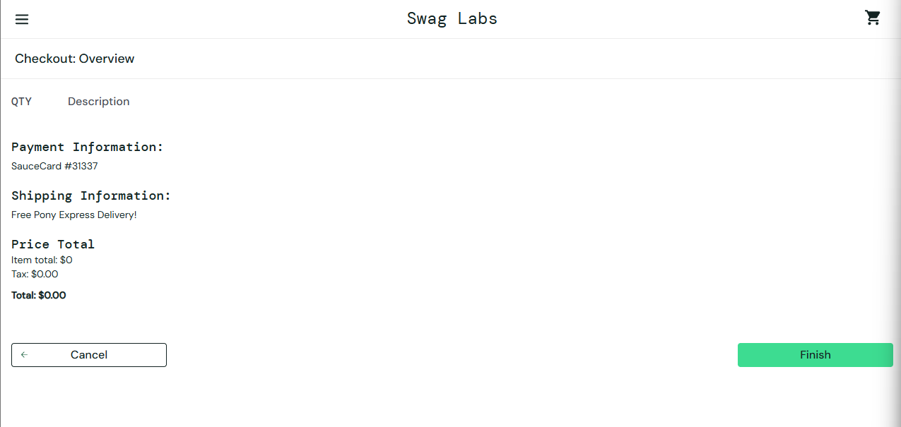

# ST-11: [Checkout] Back button reopens a $0.00 checkout

| Severity | Priority | Test case | Account | Environment |
| --- | --- | --- | --- | --- |
| high | medium | CHK-17 | standard_user | Windows 11 · Chrome 155 · 1920×1080 |

## Preconditions
1. Log in as standard_user.
2. Make sure Sauce Labs Backpack is in the cart.
3. Click the cart icon.
5. Click Checkout.

## Steps to reproduce

1. Enter Jane / Doe / 12345
2. Click Continue
3. Click Finish
4. On the confirmation page, press the browser Back button

## Expected result
After clicking Finish, the user should not be able to return to Checkout: Overview. If they go back, they should be redirected away from the completed checkout.

## Actual result
After the order is completed, pressing the browser Back button reopens Checkout: Overview with an empty cart and a $0.00 total. The order can then be finished again.

## Evidence

## Impact

## Suggested action
