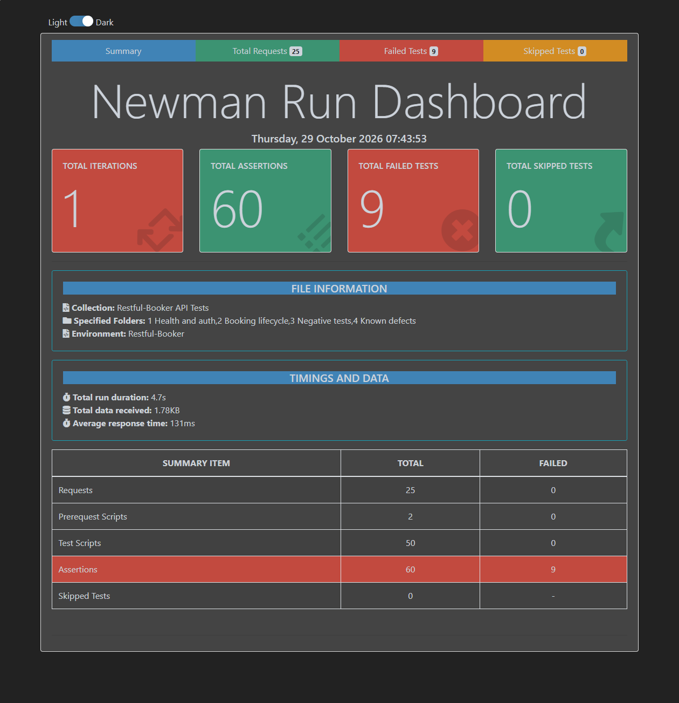

# API Testing: Restful-Booker


An automated Postman suite that tests every endpoint of the [Restful-Booker](https://restful-booker.herokuapp.com/apidoc/index.html) booking API with chained, negative, schema and data-driven tests, run by Newman on every push through GitHub Actions.

| Tests | Endpoints | Defects logged | Data-driven rows | Runs in CI |
| --- | --- | --- | --- | --- |
| 25 | 8 of 8 | 10 | 5 | Yes |

## What's covered

| Endpoint | Tests |
| --- | --- |
| `GET /ping` | API-01 |
| `POST /auth` | API-02, API-16 |
| `POST /booking` | API-03, API-15, API-17 to API-21, API-24 (setup), API-25 |
| `GET /booking/{id}` | API-04, API-09, API-13 |
| `GET /booking` (search) | API-05, API-24 |
| `PUT /booking/{id}` | API-06, API-10, API-14, API-22 |
| `PATCH /booking/{id}` | API-07, API-11 |
| `DELETE /booking/{id}` | API-08, API-12, API-23 |

## Test suite

| ID | Name | Folder | Result |
| --- | --- | --- | --- |
| API-01 | Health check responds | 1 Health and auth | Pass |
| API-02 | Valid login returns a token | 1 Health and auth | Pass |
| API-03 | Create a booking | 2 Booking lifecycle | Pass |
| API-04 | Get the booking by ID | 2 Booking lifecycle | Pass |
| API-05 | Search by name finds the booking | 2 Booking lifecycle | Pass |
| API-06 | Update the whole booking (PUT) | 2 Booking lifecycle | Pass |
| API-07 | Update one field (PATCH) | 2 Booking lifecycle | Pass |
| API-08 | Delete the booking | 2 Booking lifecycle | Pass |
| API-09 | Deleted booking is gone | 2 Booking lifecycle | Pass |
| API-10 | PUT without a token is refused | 3 Negative tests | Pass |
| API-11 | PATCH without a token is refused | 3 Negative tests | Pass |
| API-12 | DELETE without a token is refused | 3 Negative tests | Pass |
| API-13 | Unknown booking ID returns 404 | 3 Negative tests | Pass |
| API-14 | PUT with missing fields is rejected | 3 Negative tests | Pass |
| API-15 | Malformed JSON returns 400 | 4 Known defects | Fail → RB-10 |
| API-16 | Wrong password returns 401 | 4 Known defects | Fail → RB-1 |
| API-17 | Missing lastname returns 400 | 4 Known defects | Fail → RB-2 |
| API-18 | Text totalprice is rejected | 4 Known defects | Fail → RB-3 |
| API-19 | Checkout before check-in is rejected | 4 Known defects | Fail → RB-4 |
| API-20 | Spaces-only firstname is rejected | 4 Known defects | Fail → RB-5 |
| API-21 | Decimal totalprice is saved exactly | 4 Known defects | Fail → RB-6 |
| API-22 | PUT on an unknown ID returns 404 | 4 Known defects | Fail → RB-7 |
| API-23 | DELETE on an unknown ID returns 404 | 4 Known defects | Fail → RB-8 |
| API-24 | Check-in filter includes the boundary date | 4 Known defects | Fail → RB-9 |
| API-25 | Create a booking from each data row (5 rows) | 5 Data-driven | Pass |

## Defects found

The most serious defects let bad data in without any error. A booking can be saved with a text price (stored as null), with a checkout date before its check-in, or with a decimal price silently cut to a whole number. Several error cases also return the wrong status code: a failed login returns 200, and missing fields or malformed JSON return 500, which reports a client mistake as a server failure. All 10 defects, with severity, priority and the test that found each one, are listed in [bug-reports/README.md](bug-reports/README.md).

## Observations (not logged as bugs)

- `GET /ping` and `DELETE /booking/{id}` return **201 Created**. Most APIs return 200 or 204, but this matches the API's documentation, so the tests check for 201.
- Requests without a token return **403 Forbidden**. Strictly, 401 is more precise when no credentials are sent, but 403 is common in practice and was accepted.

## Reports



- [Full run report](reports/full-run-report.html): folders 1 to 4
- [Data-driven run report](reports/data-driven-report.html): folder 5, all 5 rows

GitHub displays HTML files as code; download a report and open it in a browser to view it.

## How to run it

**Postman:** import `restful-booker.postman_collection.json` and `restful-booker.postman_environment.json`, then select the **Restful-Booker** environment.

**Newman** (requires Node.js and `npm install -g newman newman-reporter-htmlextra`):

```bash
newman run restful-booker.postman_collection.json -e restful-booker.postman_environment.json --folder "1 Health and auth" --folder "2 Booking lifecycle" --folder "3 Negative tests" --folder "4 Known defects" -r "cli,htmlextra" --reporter-htmlextra-export reports/full-run-report.html
```

```bash
newman run restful-booker.postman_collection.json -e restful-booker.postman_environment.json --folder "5 Data-driven" -d data/bookings.csv -r "cli,htmlextra" --reporter-htmlextra-export reports/data-driven-report.html
```

The environment file holds only the demo credentials published in the Restful-Booker docs (`admin` / `password123`).

## Tools

Postman · Newman · newman-reporter-htmlextra · GitHub Actions · Jira · JavaScript · JSON
